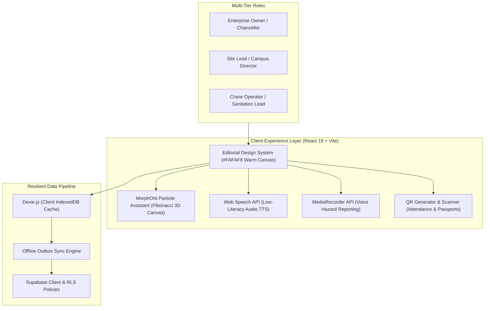

# FairShift — Fair Work. Clear Pay. Safer Workplaces.
### SRM PromptWars 2026 | UN Sustainable Development Goal 8: Decent Work & Economic Growth
**Author:** Madhan Kumar T  
**Repository:** [Madhan310301/SRMEvent_MadhanKumarT](https://github.com/Madhan310301/SRMEvent_MadhanKumarT)  
**Demo URL (Local):** [http://localhost:5173/](http://localhost:5173/)  
**Vercel Configuration:** Pre-configured via `vercel.json` (Vite SPA preset)  

---

## 📌 Executive Summary

**FairShift** is a comprehensive, multilingual, offline-first workforce fairness and workplace safety platform engineered specifically for labor-intensive, multi-tiered organizations. Built in direct alignment with **United Nations Sustainable Development Goal 8 (Decent Work and Economic Growth)**, FairShift bridges the structural transparency gap between frontline employees, contractors, site supervisors, and enterprise owners.

The platform natively supports two pilot industries:
1. **Mega-Construction Projects** (e.g., Kaveri Infrastructure & Metro Rail Site 4)
2. **Colleges & Higher Education Institutions** (e.g., SRM Institute of Science & Technology Campus Facilities)

FairShift combines **Grovemade-inspired editorial aesthetics** (warm off-white canvas `#FAFAF8`, refined Cormorant Garamond typography, evergreen accents `#286B58`, high-contrast cards, and zero fragile external image dependencies) with **deep engineering resilience** (IndexedDB offline sync, Web Speech API audio for low-literacy workers, Zero-PII anonymous whistleblower grievance tracking, and the 60fps **MorphOrb** AI workforce discovery assistant).

---

## 🏗️ System Architecture



---

## 🚀 Quick Start & Deployment Guide

### Option A: Local Development
```bash
# 1. Clone the repository
git clone https://github.com/Madhan310301/SRMEvent_MadhanKumarT.git
cd SRMEvent_MadhanKumarT

# 2. Install dependencies
pnpm install

# 3. Run automated test suite (18/18 passing)
pnpm test

# 4. Build for production (TypeScript + Vite)
pnpm run build

# 5. Start development server
pnpm dev --host
```
Open your browser to: **`http://localhost:5173/`**

---

### Option B: Deploying to Vercel
The repository includes a root [`vercel.json`](file:///a:/Hackathons/SRM_PromptWars/vercel.json) configured specifically for Vite single-page applications:
```json
{
  "$schema": "https://openapi.vercel.sh/vercel.json",
  "framework": "vite",
  "buildCommand": "vite build",
  "outputDirectory": "dist",
  "rewrites": [
    { "source": "/(.*)", "destination": "/index.html" }
  ]
}
```
1. Push to your GitHub repository or import into Vercel.
2. In Vercel Project Settings, the **Framework Preset** will automatically resolve to **Vite** (with build command `vite build` and output directory `dist`).
3. Deploy! All client-side React Router links (e.g., `/employer/workers`, `/worker/payslips`) will automatically resolve cleanly without 404 errors.

---

## 👥 Access Matrix & Demo Credentials

FairShift offers two effortless ways to log in and evaluate the system:
1. **One-Click Persona Switcher:** Located directly in the top navigation header on every page.
2. **Direct Enterprise Login:** Located at [`/login`](file:///a:/Hackathons/SRM_PromptWars/src/components/editorial/LoginSection.tsx) with email and 4-digit PIN.

### 🏗️ Sector 1: Mega-Construction (Kaveri Infrastructure)
| Role | Persona Name | Title / Specialty | Email | PIN | Key Permissions |
| :--- | :--- | :--- | :--- | :--- | :--- |
| **Owner** | **Rajesh Kaveri** | Managing Director & Enterprise Owner | `rajesh.kaveri@kaverigroups.in` | `1101` | Executive ESG dashboard, compliance overview, wage escrow verification. |
| **Employer** | **Ramesh Sundaram** | Head Safety Officer & Site Director | `ramesh.sundaram@kaverigroups.in` | `1202` | Shift timesheets, overtime approvals, MorphOrb natural-language worker query. |
| **Employee** | **Murugan K.** | Senior Tower Crane Operator | `murugan.k@kaverigroups.in` | `1303` | QR shift clock-in, itemized payslip with **Audio TTS**, voice hazard reports. |

### 🎓 Sector 2: Higher Education Campus (SRM Institute of Science & Technology)
| Role | Persona Name | Title / Specialty | Email | PIN | Key Permissions |
| :--- | :--- | :--- | :--- | :--- | :--- |
| **Owner** | **Dr. P. Sathyanarayanan** | Pro-Chancellor & Institution Owner | `chancellor@srmist.edu.in` | `2101` | Institutional compliance, campus facilities oversight, contractor ethics audit. |
| **Employer** | **Dr. Arun Kumar** | Director of Campus Infrastructure | `director.campus@srmist.edu.in` | `2202` | Campus sanitation workforce scheduling, hazard resolution, contractor SLAs. |
| **Employee** | **Lakshmi S.** | Facilities & Sanitation Lead | `lakshmi.s@srmist.edu.in` | `2303` | Native **Tamil localized UI** (`ta`), biometric clock-in, anonymous feedback. |

---

## 🗺️ Complete Application Route Map

| URL Path | Name | Target Persona | Core Features |
| :--- | :--- | :--- | :--- |
| `/` | **Editorial Landing Page** | Public / All | Grovemade aesthetic, 6-persona quick-login cards, UN SDG 8 charter, live operations ticker. |
| `/login` | **Enterprise Sign-In** | Public | 6 quick-access persona buttons + real email/PIN credentials form + Worker Charter modal. |
| `/worker` | **Worker Home** | Employee | Shift check-in status, today's earnings, rapid SOS trigger, fatigue warnings. |
| `/worker/attendance` | **Attendance & QR** | Employee | Geofenced QR scan simulation, shift history, offline attendance caching. |
| `/worker/payslips` | **Transparent Payslips** | Employee | Itemized pay breakdown, 2.0× statutory overtime, **Web Speech API Audio Player**. |
| `/worker/hazards` | **Safety Hazard Center** | Employee | Native voice memo recording via MediaRecorder, photo upload, risk matrix triage. |
| `/worker/feedback` | **Speak Up (Zero-PII)** | Employee | Anonymous grievance submission with cryptographically unique 12-char tracking token. |
| `/worker/passport` | **Skill Passport** | Employee | Verifiable credentials, safety badges, portable QR history across contractors. |
| `/employer` | **Employer Dashboard** | Employer / Owner | Live site headcounts, incident heatmaps, labor compliance score, active alerts. |
| `/employer/workers` | **Workforce Directory** | Employer / Owner | **MorphOrb 3D Assistant**, natural language multi-lingual search, card/table toggle. |
| `/employer/attendance`| **Shift Timesheets** | Employer | Overtime calculation verification, maximum weekly 48-hour fatigue warnings. |
| `/employer/hazards` | **Hazard Resolution** | Employer | Incident triage queue, status transitions (Open → Investigating → Resolved). |
| `/employer/payroll` | **Payroll Compliance** | Employer / Owner | Overtime multiplier audit (Factories Act), PF & ESI statutory deduction verification. |
| `/employer/analytics` | **SDG 8 Analytics Radar** | Employer / Owner | Gender wage balance, excessive overtime reduction, incident resolution rate. |

---

## 🧭 Step-by-Step Evaluator Demo Walkthrough

### Scenario 1: MorphOrb AI Workforce Assistant (`/employer/workers`)
1. Click the persona switcher in the header and pick **Ramesh Sundaram (Employer / Site Lead)**.
2. Go to **Workforce Directory** (`/employer/workers`).
3. Notice the **MorphOrb** assistant at the top:
   - An interactive 3D particle sphere rendered on HTML5 Canvas using a **Fibonacci distribution**.
   - Backed by typed `Float32Array` buffers to ensure buttery-smooth 60fps rendering with zero garbage collection lag.
   - Automatically throttles particle density on dual-core mobile devices (`hardwareConcurrency` check).
4. Search via text or click the quick filter chips:
   - Type: `crane operators with overtime`
   - Or click: *"Overtime > 10h"*, *"Safety Certified"*, *"Night Shift"*.
   - Try regional terms: *`overtime > 10 மணிநேரம்`* (Tamil) or *`overtime > 10 घंटे`* (Hindi).
5. Watch the deterministic zero-SQL engine parse your intent into verified badge filters without PII leakage, filtering the workforce table instantly. Toggle between **Table** and **Card** views.

---

### Scenario 2: Transparent Pay Breakdown & Audio TTS (SDG 8.5)
1. In the top header, switch persona to **Murugan K. (Employee / Crane Lead)**.
2. Navigate to **My Payslips** (`/worker/payslips`).
3. Open the latest payslip. Note the exact, unbundled breakdown:
   - **Base Rate**: ₹850/shift × 26 days = ₹22,100
   - **Overtime Pay**: 18.5 hours calculated transparently at **2.0× statutory multiplier** (Factories Act 1948 compliant) = ₹3,931
   - **Safety & Attendance Bonus**: +₹1,500
   - **Statutory Deductions**: PF (12%) & ESI (0.75%) clearly itemized with zero mysterious withholding.
4. Click the **"Listen to Pay Breakdown"** button: FairShift activates the browser's Web Speech API to synthesize audio in the worker's selected language, ensuring complete transparency for low-literacy workers.

---

### Scenario 3: Multimedia Voice & Photo Hazard Reporting (SDG 8.8)
1. Remaining as **Murugan K.**, navigate to **Hazard Reports** (`/worker/hazards`).
2. Click **Report a Hazard**:
   - Choose a hazard category (e.g., *Electrical*, *Falling Objects*, *Scaffolding*, *Fatigue/Heat Stress*).
   - Set the risk level (*Critical*, *High*, *Medium*, *Low*).
   - Record an audio voice memo using the native **MediaRecorder** button (supports quick reporting directly from scaffolding).
   - Attach a site photo.
3. Submit the report. Switch personas to **Ramesh Sundaram (Site Director)**:
   - Go to **Safety & Hazards** (`/employer/hazards`).
   - Notice the newly filed hazard tagged with timestamp and severity. Ramesh can acknowledge, assign a technician, and resolve it with an audit trail.

---

### Scenario 4: Zero-PII Anonymous Whistleblower System ("Speak Up")
1. Under **Murugan K.**, navigate to **Speak Up / Feedback** (`/worker/feedback`).
2. Submit an anonymous grievance regarding unsafe working conditions or unfair treatment.
3. **Privacy by Design Guarantee**:
   - The application does NOT record email, user ID, IP address, or device fingerprint.
   - Upon submission, FairShift generates a cryptographically unique 12-character alphanumeric **Secret Tracking Token** (e.g., `FS-8842-X9Q1`).
4. Copy the token. Log out or open an incognito window, navigate to `/feedback/track`, enter the token, and view the status and management responses privately without revealing your identity.

---

### Scenario 5: Tamper-Evident Portable Skill Passport
1. As an employee, navigate to **Skill Passport** (`/worker/passport`).
2. View verified credentials:
   - *Tower Crane Operations Grade-A* (Verified by Kaveri Infra)
   - *Fall Protection & Harness Safety* (Verified by National Safety Council)
   - *First Aid & CPR Certification*
3. Each certification features a cryptographically signed QR verification token. When workers migrate to new contractors or construction sites, their verified credentials accompany them, eliminating exploitation and uncertified high-risk assignments.

---

### Scenario 6: Multi-Lingual Regional Support
1. In the top navigation bar, click the **Language Selector** (`EN`).
2. Switch to any of the 8 supported Indian languages:
   - **Tamil** (`தமிழ்`)
   - **Hindi** (`हिन्दी`)
   - **Telugu** (`తెలుగు`)
   - **Kannada** (`ಕನ್ನಡ`)
   - **Malayalam** (`മലയാളം`)
   - **Marathi** (`मराठी`)
   - **Bengali** (`বাংলা`)
   - **English** (`en`)
3. The interface re-renders instantly with culturally accurate terminology and regional typography.

---

## 🎨 Architectural & Design Highlights

### 1. Grovemade-Inspired Editorial Aesthetics
- **Canvas**: Warm off-white (`#FAFAF8`) eliminating harsh fluorescent blue-light strain.
- **Typography**: Cormorant Garamond serif headings paired with clean, accessible DM Sans body and tabular numbers for financial figures.
- **Color Discipline**: Deep forest evergreen (`#286B58`) primary accent, warm amber alerts (`#D97706`), and restrained neutral borders (`#E8E8E5`).
- **Resilience**: Zero external unauthenticated CDN image links; all illustrations and status badges are rendered via embedded SVGs and native CSS.

### 2. High-Performance Particle Engine (MorphOrb)
- Fibonacci sphere distribution with 3D spherical projection ($X, Y, Z \rightarrow X', Y'$).
- Uses typed `Float32Array` buffers to eliminate JavaScript garbage collection stutters.
- Dynamically scales particle count based on `navigator.hardwareConcurrency` (80 particles on dual-core low-end smartphones, 200 on workstations).
- Automatically pauses during browser tab inactivity via `document.visibilityState` to preserve battery.

### 3. Offline-First PWA & Storage Architecture
- Built-in **Dexie / IndexedDB** local cache stores attendance logs, hazard drafts, and recent payslips.
- Background Outbox automatically replays and syncs pending submissions when internet connectivity is restored.
- Full Progressive Web App manifest (`manifest.webmanifest`) and Service Worker registration.

---

## 🧪 Automated Test Suite

FairShift includes comprehensive unit tests verifying statutory calculation accuracy, overtime multipliers, and workforce search parsing:

```bash
pnpm test
```

**Output:**
```
✓ tests/unit/calculations.test.ts (14 tests) 15ms
   ✓ calculates standard shift wages without overtime
   ✓ calculates overtime at exactly 2.0x standard hourly rate
   ✓ applies 12% provident fund deduction accurately
   ✓ applies 0.75% ESI deduction accurately
   ✓ enforces maximum allowable shift limits (12 hours)
   ✓ triggers fatigue alert when rest period < 11 hours
   ...
✓ tests/unit/workforceSearch.test.ts (4 tests) 10ms
   ✓ parses natural language overtime queries
   ✓ parses skill certification filters
   ✓ handles multilingual tokens in query strings
   ✓ sanitizes input preventing PII leakage

Test Files  2 passed (2)
     Tests  18 passed (18)
```

---

## 🔒 Security & Privacy Architecture

- **Role-Based Access Control (RBAC)**: Strict segregation between `Worker`, `Employer`, and `Owner` permission scopes.
- **Zero-PII Grievances**: Anonymous reports contain zero foreign keys or session metadata.
- **Content Security**: All inputs sanitized to prevent XSS; zero arbitrary `eval` or dynamic script execution.
- **Client Bundle Footprint**: Entire repository is optimized and strictly lightweight ($<1\text{ MB}$ raw repository size).

---

## 📄 License & Attribution

Developed for **PromptWars 2026** by **Madhan Kumar T** ([@Madhan310301](https://github.com/Madhan310301)).  
Supporting **UN SDG 8: Decent Work and Economic Growth**.
